# HANOI PM2.5 AIR QUALITY FORECASTING — AI MLOPS CI/CD & DOCKER DEPLOYMENT
### BÀI THỰC HÀNH 3: TRIỂN KHAI CI/CD & BUILD DOCKER IMAGE CHO MÔ HÌNH AI

- **Họ và tên sinh viên:** Nguyễn Hồng Phúc
- **Mã số sinh viên (MSSV):** 2351260680
- **Lớp:** 65TTNT
- **Học phần:** Chuyên đề Trí tuệ Nhân tạo
- **Mô hình AI:** SOFTS (*Series-Core Fusion*) tích hợp backbone **DINOv3 ViT-S/16**
- **Docker Hub Repository:** [`https://hub.docker.com/r/phucnguyen210/hanoi-pm25-softs-dinov3`](https://hub.docker.com/r/phucnguyen210/hanoi-pm25-softs-dinov3)

---

## 1. TỔNG QUAN HỆ THỐNG & KIẾN TRÚC CI/CD

Dự án triển khai một quy trình MLOps tự động hóa hoàn chỉnh (Continuous Integration / Continuous Deployment) cho bài toán dự báo ô nhiễm không khí chuỗi thời gian đa biến (Multivariate Time-series Forecasting) tại Hà Nội:

```mermaid
flowchart LR
    Dev[🧑‍💻 Developer] -->|git push main| GitHub[🐙 GitHub Repository]
    subgraph CI [1. Continuous Integration]
        GitHub --> Runner[🖥️ GitHub Actions Runner]
        Runner --> Lint[📦 Setup Python 3.10 & Pip]
        Lint --> Pytest[🔬 Run Pytest Suite]
        Pytest --> TestModel[🧪 Test Checkpoint & Tensor Shape]
        Pytest --> TestAPI[🌐 Test FastAPI Endpoints]
    end
    subgraph CD [2. Continuous Deployment]
        TestAPI -->|Passed| Buildx[🔧 Docker Buildx]
        Buildx --> Auth[🔑 Auth Docker Hub Secrets]
        Auth --> BuildImage[🐳 Build Image: py3.10-slim]
        BuildImage --> PushHub[🚀 Push Docker Hub Public]
    end
    PushHub --> EndUser[👥 End Users / Edge Servers]
    EndUser -->|docker run| Container[📦 Container Instance :7860]
```



---

## 2. CẤU TRÚC THƯ MỤC DỰ ÁN

```text
├── .github/
│   └── workflows/
│       └── ci_cd.yml               # Pipeline GitHub Actions CI/CD hoàn chỉnh
├── layers/                         # Các module kiến trúc DINOv3 (RoPE, Transformer Block)
├── models/                         # Kiến trúc mô hình SOFTS-DINOv3
├── static/                         # Tài nguyên giao diện Web Dashboard
├── templates/                      # Template render
├── tests/                          # Bộ kiểm thử tự động
│   ├── test_model.py               # Kiểm tra checkpoint và suy luận tensor nơ-ron
│   └── test_api.py                 # Kiểm tra endpoint FastAPI (/health, /api/predict)
├── .dockerignore                   # Danh sách loại trừ tối ưu dung lượng Docker image
├── .gitignore                      # Danh sách loại trừ Git
├── app.py                          # Serving Engine & Web Dashboard
├── Dockerfile                      # Chỉ dẫn đóng gói Docker container chuẩn MLOps
├── index.html                      # Giao diện giám sát & dự báo thời gian thực
├── model_config.json               # Tham số cấu hình siêu tham số mô hình
├── requirements.txt                # Thư viện phụ thuộc (PyTorch CPU, FastAPI, Pytest)
├── softs_dinov3_hanoi.pt           # Checkpoint trọng số mô hình đã huấn luyện
└── README.md                       # Tài liệu hướng dẫn & báo cáo
```

---

## 3. BỘ KIỂM THỬ TỰ ĐỘNG (UNIT & INTEGRATION TESTS)

Bộ kiểm thử được viết bằng `pytest` đặt trong thư mục `tests/`:
1. **Kiểm tra Checkpoint (`test_model_file_exists`, `test_checkpoint_loading`)**:
   - Xác thực file `softs_dinov3_hanoi.pt` tồn tại, dung lượng hợp lệ (> 3.5 MB).
   - Nạp thành công toàn bộ `state_dict` vào cấu trúc mô hình mạng nơ-ron.
2. **Kiểm tra Forward Pass (`test_model_forward_shape_and_values`)**:
   - Truyền tensor đầu vào kích thước `(1, 96, 7)`.
   - Xác nhận output trả về kích thước `(1, 24, 7)`.
   - Kiểm tra dữ liệu hợp lệ (không chứa `NaN` hay `Inf`).
3. **Kiểm tra API Serving (`test_health_check_endpoint`, `test_predict_endpoint_with_csv_upload`)**:
   - Endpoint `/health` trả về status 200 và thông tin `healthy`.
   - Endpoint `/api/predict` thực hiện suy luận offline từ file CSV mẫu và trả về đủ 24 mốc dự báo cùng các chỉ số đánh giá `MAE`, `RMSE`.

Lệnh chạy kiểm thử cục bộ:
```bash
python -m pytest tests/ -v
```

---

## 4. HƯỚNG DẪN STEP-BY-STEP ĐỂ CLONE VÀ CHẠY DỰ ÁN (FOR REVIEWERS & USERS)

Bất kỳ ai (thầy cô, người phản biện hoặc người dùng khác) đều có thể dễ dàng clone và vận hành hệ thống dự báo AI theo 1 trong các phương thức dưới đây:

---

### PHƯƠNG THỨC A: CHẠY TRỰC TIẾP TỪ DOCKER HUB (NHANH NHẤT — KHÔNG CẦN CÀI PYTHON)
*(Thích hợp nhất để kiểm thử nhanh mà không cần clone mã nguồn)*

```bash
# 1. Tải Docker Image đã được CI/CD build sẵn từ Docker Hub
docker pull phucnguyen210/hanoi-pm25-softs-dinov3:latest

# 2. Khởi chạy Container phục vụ dự báo trên cổng 7860
docker run -d --name hanoi_pm25_app -p 7860:7860 phucnguyen210/hanoi-pm25-softs-dinov3:latest

# 3. Mở trình duyệt web để sử dụng hệ thống
# URL: http://localhost:7860
```

---

### PHƯƠNG THỨC B: CLONE REPO VÀ BUILD DOCKER CỤC BỘ
*(Thích hợp khi muốn tải toàn bộ mã nguồn về và tự đóng gói container)*

```bash
# Bước 1: Clone mã nguồn từ GitHub
git clone https://github.com/nguyenphuc210/hanoi-pm25-ai-cicd.git
cd hanoi-pm25-ai-cicd

# Bước 2: Tự đóng gói Docker Image từ Dockerfile
docker build -t hanoi-pm25-local:latest .

# Bước 3: Khởi chạy container từ image vừa build
docker run -d --name hanoi_pm25_local_app -p 7860:7860 hanoi-pm25-local:latest

# Bước 4: Mở trình duyệt tại http://localhost:7860
```

---

### PHƯƠNG THỨC C: CLONE REPO VÀ CHẠY VỚI PYTHON CỤC BỘ (LOCAL ENVIRONMENT)
*(Thích hợp cho lập trình viên muốn xem code, debug hoặc chạy bộ Unit Test)*

#### 1. Yêu cầu hệ thống:
- Python 3.10 hoặc cao hơn (khuyên dùng Python 3.10 – 3.13).
- Git.

#### 2. Các bước thực hiện:
```bash
# Bước 1: Clone kho lưu trữ
git clone https://github.com/nguyenphuc210/hanoi-pm25-ai-cicd.git
cd hanoi-pm25-ai-cicd

# Bước 2: Tạo và kích hoạt môi trường ảo (Virtualenv)
python -m venv venv

# Kích hoạt trên Windows (PowerShell / CMD):
venv\Scripts\activate
# (Hoặc trên Linux / macOS):
# source venv/bin/activate

# Bước 3: Cài đặt thư viện phụ thuộc (đã tối ưu bản PyTorch CPU ~180MB)
pip install --upgrade pip
pip install -r requirements.txt

# Bước 4: Chạy kiểm thử tự động (Unit & Integration Tests)
python -m pytest tests/ -v
# Kết quả mong đợi: 7 passed in ~10s

# Bước 5: Khởi chạy dịch vụ FastAPI Web Serving
python -m uvicorn app:app --host 0.0.0.0 --port 7860
# (Hoặc: python app.py)
```

---

### HƯỚNG DẪN NGHIỆM THU KẾT QUẢ
Sau khi khởi chạy (theo bất kỳ phương thức nào ở trên):
1. **Giao diện Web Dashboard:** Mở trình duyệt truy cập 👉 `http://localhost:7860`
   - Bấm nút **`▶ RUN AI INFERENCE`** để kích hoạt mô hình SOFTS-DINOv3 dự báo 24 giờ tiếp theo.
   - Thử chọn các trạm quan trắc khác nhau (Đống Đa, Cầu Giấy, Hoàn Kiếm, Ba Đình, v.v.) hoặc upload file CSV tùy chỉnh.
2. **Kiểm tra API giám sát sức khỏe (Health Check):**
   ```bash
   curl http://localhost:7860/health
   ```
   *Kết quả JSON trả về:*
   ```json
   {
     "status": "healthy",
     "service": "Hanoi PM2.5 Air Quality Forecasting",
     "model": "SOFTS with DINOv3 ViT Backbone",
     "backend": "FastAPI + PyTorch CPU",
     "stations_count": 10
   }
   ```
3. **Tài liệu API tương tác tự động (Swagger UI):**
   - Truy cập: 👉 `http://localhost:7860/docs` để kiểm thử trực tiếp các endpoint API.

---

## 5. CẤU HÌNH GITHUB SECRETS CHO CI/CD PIPELINE

Để GitHub Actions có quyền đẩy image lên Docker Hub, cần thiết lập 2 biến Secret trong Repository GitHub (**Settings -> Secrets and variables -> Actions -> New repository secret**):

1. **`DOCKERHUB_USERNAME`**: Tên đăng nhập Docker Hub (`nguyenphuc210`).
2. **`DOCKERHUB_TOKEN`**: Personal Access Token (PAT) tạo từ Docker Hub (**Account Settings -> Security -> New Access Token** với quyền `Read & Write`).
