# HANOI PM2.5 AIR QUALITY FORECASTING — AI MLOPS CI/CD & DOCKER DEPLOYMENT
### BÀI THỰC HÀNH 3: TRIỂN KHAI CI/CD & BUILD DOCKER IMAGE CHO MÔ HÌNH AI

- **Họ và tên sinh viên:** Nguyễn Hồng Phúc
- **Mã số sinh viên (MSSV):** 2351260680
- **Lớp:** 65TTNT
- **Học phần:** Chuyên đề Trí tuệ Nhân tạo
- **Mô hình AI:** SOFTS (*Series-Core Fusion*) tích hợp backbone **DINOv3 ViT-S/16**
- **Docker Hub Repository:** [`https://hub.docker.com/r/nguyenphuc210/hanoi-pm25-softs-dinov3`](https://hub.docker.com/r/nguyenphuc210/hanoi-pm25-softs-dinov3)

---

## 1. TỔNG QUAN HỆ THỐNG & KIẾN TRÚC CI/CD

Dự án triển khai một quy trình MLOps tự động hóa hoàn chỉnh (Continuous Integration / Continuous Deployment) cho bài toán dự báo ô nhiễm không khí chuỗi thời gian đa biến (Multivariate Time-series Forecasting) tại Hà Nội:

```mermaid
flowchart LR
    Dev[🧑‍💻 Developer] -->|git push main| GitHub[🐙 GitHub Repository]
    subgraph CI [1. Continuous Integration]
        GitHub --> Runner[🖥️ GitHub Actions Runner]
        Runner --> Lint[📦 Setup Python 3.10 & Pip]
        Lint --> Pytest[🔬 Run Pytest Suite]
        Pytest --> TestModel[🧪 Test Checkpoint & Tensor Shape]
        Pytest --> TestAPI[🌐 Test FastAPI Endpoints]
    end
    subgraph CD [2. Continuous Deployment]
        TestAPI -->|Passed| Buildx[🔧 Docker Buildx]
        Buildx --> Auth[🔑 Auth Docker Hub Secrets]
        Auth --> BuildImage[🐳 Build Image: py3.10-slim]
        BuildImage --> PushHub[🚀 Push Docker Hub Public]
    end
    PushHub --> EndUser[👥 End Users / Edge Servers]
    EndUser -->|docker run| Container[📦 Container Instance :7860]
```



---

## 2. CẤU TRÚC THƯ MỤC DỰ ÁN

```text
├── .github/
│   └── workflows/
│       └── ci_cd.yml               # Pipeline GitHub Actions CI/CD hoàn chỉnh
├── layers/                         # Các module kiến trúc DINOv3 (RoPE, Transformer Block)
├── models/                         # Kiến trúc mô hình SOFTS-DINOv3
├── static/                         # Tài nguyên giao diện Web Dashboard
├── templates/                      # Template render
├── tests/                          # Bộ kiểm thử tự động
│   ├── test_model.py               # Kiểm tra checkpoint và suy luận tensor nơ-ron
│   └── test_api.py                 # Kiểm tra endpoint FastAPI (/health, /api/predict)
├── .dockerignore                   # Danh sách loại trừ tối ưu dung lượng Docker image
├── .gitignore                      # Danh sách loại trừ Git
├── app.py                          # Serving Engine & Web Dashboard
├── Dockerfile                      # Chỉ dẫn đóng gói Docker container chuẩn MLOps
├── index.html                      # Giao diện giám sát & dự báo thời gian thực
├── model_config.json               # Tham số cấu hình siêu tham số mô hình
├── requirements.txt                # Thư viện phụ thuộc (PyTorch CPU, FastAPI, Pytest)
├── softs_dinov3_hanoi.pt           # Checkpoint trọng số mô hình đã huấn luyện
└── README.md                       # Tài liệu hướng dẫn & báo cáo
```

---

## 3. BỘ KIỂM THỬ TỰ ĐỘNG (UNIT & INTEGRATION TESTS)

Bộ kiểm thử được viết bằng `pytest` đặt trong thư mục `tests/`:
1. **Kiểm tra Checkpoint (`test_model_file_exists`, `test_checkpoint_loading`)**:
   - Xác thực file `softs_dinov3_hanoi.pt` tồn tại, dung lượng hợp lệ (> 3.5 MB).
   - Nạp thành công toàn bộ `state_dict` vào cấu trúc mô hình mạng nơ-ron.
2. **Kiểm tra Forward Pass (`test_model_forward_shape_and_values`)**:
   - Truyền tensor đầu vào kích thước `(1, 96, 7)`.
   - Xác nhận output trả về kích thước `(1, 24, 7)`.
   - Kiểm tra dữ liệu hợp lệ (không chứa `NaN` hay `Inf`).
3. **Kiểm tra API Serving (`test_health_check_endpoint`, `test_predict_endpoint_with_csv_upload`)**:
   - Endpoint `/health` trả về status 200 và thông tin `healthy`.
   - Endpoint `/api/predict` thực hiện suy luận offline từ file CSV mẫu và trả về đủ 24 mốc dự báo cùng các chỉ số đánh giá `MAE`, `RMSE`.

Lệnh chạy kiểm thử cục bộ:
```bash
python -m pytest tests/ -v
```

---

## 4. HƯỚNG DẪN KÉO VÀ CHẠY DOCKER CONTAINER

Sau khi CI/CD tự động build và push lên Docker Hub, bất kỳ người dùng hoặc máy chủ nào cũng có thể chạy hệ thống chỉ với 1 câu lệnh mà không cần cài đặt Python hay PyTorch:

### Kéo Docker Image từ Docker Hub
```bash
docker pull nguyenphuc210/hanoi-pm25-softs-dinov3:latest
```

### Khởi chạy Container
```bash
docker run -d --name hanoi_pm25_app -p 7860:7860 nguyenphuc210/hanoi-pm25-softs-dinov3:latest
```

### Truy cập ứng dụng
- Mở trình duyệt web: `http://localhost:7860`
- Kiểm tra trạng thái sức khỏe dịch vụ: `http://localhost:7860/health`
- Gửi yêu cầu dự báo API: `POST http://localhost:7860/api/predict`

---

## 5. CẤU HÌNH GITHUB SECRETS CHO CI/CD PIPELINE

Để GitHub Actions có quyền đẩy image lên Docker Hub, cần thiết lập 2 biến Secret trong Repository GitHub (**Settings -> Secrets and variables -> Actions -> New repository secret**):

1. **`DOCKERHUB_USERNAME`**: Tên đăng nhập Docker Hub (`nguyenphuc210`).
2. **`DOCKERHUB_TOKEN`**: Personal Access Token (PAT) tạo từ Docker Hub (**Account Settings -> Security -> New Access Token** với quyền `Read & Write`).
